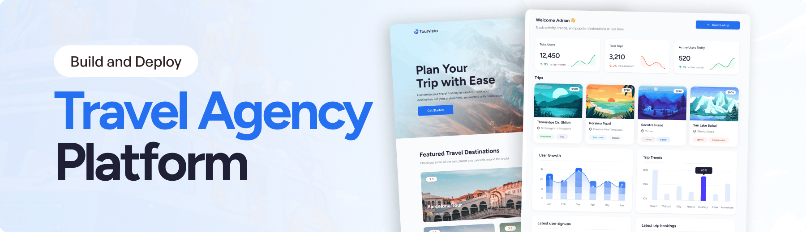

  

  <h1>✈️ Travel Agency Platform</h1>

  
A travel planning platform for generating personalized AI-powered itineraries, exploring trips, and managing travel bookings.

  

    
    
    
    
  

📌 About the Project

The Travel Agency Platform is a personal web development project that brings trip discovery, AI-assisted itinerary planning, and travel management together in one application.

Users can generate personalized travel itineraries based on their destination, budget, interests, travel style, trip duration, and group type. The platform also includes a public-facing travel experience and an admin dashboard for viewing users, trips, and analytics.

The project gave me hands-on experience with modern React development, integrating backend services, working with AI APIs, and building data-driven dashboards.

✨ Features

AI-Powered Itinerary Generation — Generate trip plans tailored to a destination, budget, interests, travel style, duration, and group type.

Trip Discovery and Booking — Browse trip details and access the booking flow from the public-facing website.

Admin Dashboard — Manage and review trip and user information from a centralized dashboard.

User Management — View user information and track user growth.

Trip Analytics — Explore trip statistics and user activity through charts and tables.

Detailed Trip Views — Review itineraries, destinations, estimated prices, and other trip information.

Destination Selection — Select a country and view its location on an interactive map.

Authentication — Use Appwrite authentication to support account access.

Responsive Interface — Navigate the application through a modern layout designed for different screen sizes.

Reusable Components — Keep the application organized with modular components and shared utilities.

🧰 Tech Stack

Frontend: React 19, React Router v7

Build Tool: Vite

Language: TypeScript

Styling: Tailwind CSS

UI Components, Charts, and Maps: Syncfusion

Backend Services, Authentication, and Database: Appwrite

AI Integration: Google Gemini API

Payments: Stripe

Images: Unsplash

🏗️ Project Highlights

Integrated AI-assisted trip planning into a travel-focused web application.

Connected frontend workflows with Appwrite services for authentication and data management.

Built dashboard views to present user and trip metrics.

Used charts, tables, maps, and reusable UI components to organize information.

Managed configuration through environment variables for external services.

🚀 Getting Started

Follow these steps to run the project locally.

Prerequisites

Install the following tools before getting started:

Git

Node.js

npm

1. Clone the Repository

Replace the repository URL below with your GitHub repository URL.

git clone <your-github-repository-url>
cd <your-project-folder>

2. Install Dependencies

npm install

3. Configure Environment Variables

Create a .env file in the project root and add the variables required by the application:

VITE_SYNCFUSION_LICENSE_KEY=
VITE_APPWRITE_PROJECT_ID=
VITE_APPWRITE_API_ENDPOINT=
VITE_APPWRITE_DATABASE_ID=
VITE_APPWRITE_USERS_COLLECTION_ID=
VITE_APPWRITE_ITINERARY_COLLECTION_ID=
VITE_BASE_URL=http://localhost:5173

GEMINI_API_KEY=
STRIPE_SECRET_KEY=
UNSPLASH_ACCESS_KEY=

Add the credentials for the services you have configured. Check the codebase for any additional environment variables required by your local setup.

Security: Do not commit real API keys, payment secrets, or other credentials to GitHub. Variables prefixed with VITE_ are exposed to the client bundle, so never store private server-side secrets in them. Keep secret keys on the server and access them through secure server-side code.

4. Start the Development Server

npm run dev

Open http://localhost:5173 in your browser.

🔐 External Services

The application may require configuration for these services, depending on which features you use:

Appwrite — Authentication and database services

Google AI Studio — Gemini API access for itinerary generation

Syncfusion — UI components, charts, and maps

Stripe — Payment and booking-related workflows

Unsplash — Travel imagery

🛣️ Potential Future Improvements

Add more advanced trip search and filtering.

Improve booking status and payment-flow management.

Add itinerary editing and saved-trip functionality.

Strengthen role-based access control for administrative features.

Expand analytics with additional date ranges and travel insights.

Add automated tests for key user flows.

👨‍💻 About

This is a personal project focused on building a modern travel planning experience and strengthening my skills in frontend development, API integration, authentication, AI-powered features, and dashboard development.

If you have suggestions or feedback, feel free to open an issue or connect through GitHub.
